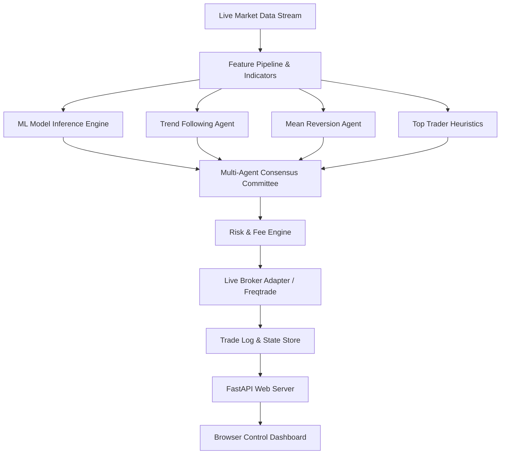

# Algorithmic Trading System (Python, FastAPI) 📈🤖

[](https://python.org/)
[](https://fastapi.tiangolo.com/)
[](https://scikit-learn.org/)
[](LICENSE)

> **Algorithmic Trading System** is an institutional-grade, multi-agent quantitative trading engine and real-time portfolio management platform powered by **Python**, **FastAPI**, **Scikit-Learn**, and **Freqtrade**. Features a multi-agent consensus committee, dynamic risk governor, brokerage execution adapter, and live browser monitoring dashboard.

---

## 🌟 Key Highlights

- **Multi-Agent Consensus Committee**: Decentralized agent decision architecture (`consensus_committee.py`) combining Trend-Following, Mean-Reversion, Volume-Spread Analysis, and Top-Trader heuristic rules before triggering order dispatch.
- **Machine Learning Predictive Signals**: Trained ensemble model (`trained_ai_model.joblib`) predicting micro-regime transitions and volatility breakouts.
- **FastAPI Real-Time Telemetry**: High-throughput REST & WebSocket endpoints (`stock_server.py`) serving live order execution states, PnL analytics, and active risk envelopes.
- **Dynamic Fee & Slippage Modeling**: Custom Groww/Zerodha/Binance broker calculation engine (`groww_fee_engine.py`) accounting for regulatory taxes, exchange turnover fees, and STT.
- **Paper & Live Execution Modes**: Instant mode-switching between safe simulation and live exchange routing.

---

## 🏗️ System Architecture



---

## 📂 Project Structure

```
TRADING BOT/
├── ai_engine/
│   ├── consensus_committee.py  # Multi-agent consensus voting engine
│   ├── stock_server.py         # FastAPI backend server
│   ├── stock_trader.py         # Execution loop & signal orchestration
│   ├── model_trainer.py        # ML training & validation pipeline
│   ├── top_trader_rules.py     # Quantitative rule filters
│   ├── live_broker_adapter.py  # Brokerage order router
│   └── groww_fee_engine.py     # Regulatory & transaction fee simulator
├── dashboard/                  # Lightweight dark-mode browser monitor
├── freqtrade/                  # Battle-tested backtesting configurations
├── scripts/                    # Automation & startup shell scripts
├── tests/                      # Pytest test suites
├── .env.example                # Sample environment template
└── README.md
```

---

## 🛠️ Quick Start

### 1. Setup Virtual Environment
```bash
git clone https://github.com/Dk043131/algorithmic-trading-system.git
cd algorithmic-trading-system
python3 -m venv venv
source venv/bin/activate
pip install -r scripts/requirements.txt # or install fastapi uvicorn scikit-learn pandas numpy
```

### 2. Configure Environment
```bash
cp .env.example .env
# Edit .env with your paper/live keys
```

### 3. Run FastAPI Telemetry Server
```bash
python3 ai_engine/stock_server.py
```
Open `http://localhost:8000` or open `dashboard/index.html` to monitor trades.

---

## 📄 License
This project is open-source under the [MIT License](LICENSE).
